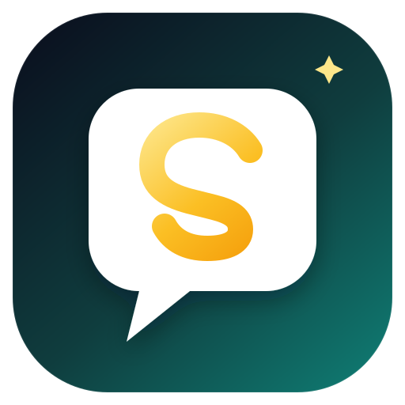

# SEMAR-GPT

<p align="center">
  
</p>

**SEMAR-GPT** adalah aplikasi asisten AI yang dibangun di atas Libre-chat.
SEMAR-GPT adalah platform asisten AI dengan nama aplikasi, logo, favicon, tema
warna, welcome screen, dan footer yang dirancang khusus untuk pengguna Indonesia.

- **Antarmuka:** React + Vite, tema navy/teal dengan aksen emas.
- **Backend:** Node.js/TypeScript, MongoDB, Meilisearch, dan RAG API.
- **Model:** provider AI populer (OpenAI, Anthropic, Google,
  Azure, Bedrock, Ollama, vLLM, LiteLLM, gateway OpenAI-compatible, dan lain-lain).
- **Skills:** 3 deployment skill dan 10 Agent Plugin (30 skill) hasil adaptasi
  proyek Cindy, plus skill buatan user.
- **Fitur kolaborasi:** Agents, Memories, Chat Projects, Schedules, Artifacts,
  dan subagents.
- **Lisensi:** lihat berkas lisensi yang disertakan. Material Cindy tetap
  Apache-2.0 (lihat [`CINDY-LICENSE.txt`](CINDY-LICENSE.txt)).

---

## Mulai cepat (Docker)

Prasyarat: Docker Desktop (atau Docker Engine + Compose plugin) sudah berjalan.

```bash
# dari root repo
./scripts/semar.sh start
```

Atau langsung:

```bash
docker compose up -d --build
```

Build pertama memakan waktu beberapa menit karena image aplikasi dibangun dari
repo ini (agar logo dan branding SEMAR-GPT ikut masuk). Setelah itu, buka
**http://localhost:3080**.

1. Daftar akun pertama. Akun pertama otomatis menjadi admin.
2. Buka **Settings → Providers** (atau menu model) dan isi API key provider,
   atau konfigurasikan gateway internal di `librechat.yaml` (lihat di bawah).
3. Mulai percakapan.

Perintah lain:

```bash
./scripts/semar.sh status    # status service
./scripts/semar.sh logs      # ikuti log API
./scripts/semar.sh restart   # restart stack
./scripts/semar.sh stop      # stop, data tetap tersimpan
./scripts/semar.sh reset     # stop + hapus volume data (destruktif)
```

> Stack Docker memakai project name `semar-gpt` dan container
> `semar-gpt-api`, `semar-gpt-mongodb`, dan seterusnya. Data tersimpan di
> volume Compose dan folder `./data-node`, `./meili_data_v1.35.1`, `./uploads`,
> `./logs`, dan `./images`.
>
> Panel admin di port **3000** merupakan tool administrasi terpisah. Jika tidak
> diperlukan, hapus service `admin-panel` dari stack.

---

## Menghubungkan model AI

### Opsi 1 — Provider bawaan (paling cepat)

Isi kunci di `.env`, lalu restart API:

```dotenv
OPENAI_API_KEY=sk-...
# ANTHROPIC_API_KEY=sk-ant-...
# GOOGLE_KEY=...
# DEEPSEEK_API_KEY=...
```

`OPENAI_API_KEY`, `ANTHROPIC_API_KEY`, dan `GOOGLE_KEY` di `.env` saat ini
bernilai `user_provided`. Nilai itu berarti endpoint aktif dan setiap pengguna
bisa memasukkan API key-nya sendiri lewat **Settings → Providers** (BYOK).
Ganti dengan kunci milik deployment jika ingin semua pengguna memakai kunci
yang sama.

### Opsi 2 — Gateway OpenAI-compatible internal

Cocok untuk vLLM, Ollama, LiteLLM, OpenRouter, atau gateway perusahaan.
Tambahkan ke `.env`:

```dotenv
SEMAR_API_BASE_URL=https://gateway.internal/v1
SEMAR_API_KEY=...
```

Lalu buka `librechat.yaml`, hapus komentar pada blok `endpoints.custom`, dan
sesuaikan `models.default` dengan nama model di gateway:

```yaml
endpoints:
  custom:
    - name: 'SEMAR'
      apiKey: '${SEMAR_API_KEY}'
      baseURL: '${SEMAR_API_BASE_URL}'
      models:
        default: ['semar-1']
        fetch: false
      titleConvo: true
      titleModel: 'semar-1'
      modelDisplayLabel: 'SEMAR-GPT'
```

Restart setelah mengubah konfigurasi:

```bash
./scripts/semar.sh restart
```

### Opsi 3 — Preset SEMAR-GPT di welcome screen

`librechat.yaml` juga menyertakan contoh `modelSpecs` yang sudah dikomentari.
Aktifkan blok itu untuk menampilkan preset **SEMAR-GPT** dengan instruksi
sistem berbahasa Indonesia di pemilih model.

---

## Skills, Agent Plugins, dan fitur Cindy

Deployment ini sudah membawa fitur dan skill hasil adaptasi proyek
Cindy:

- **3 deployment skill** di `skill/`: `skill-creator`, `learn`, dan
  `plugin-creator`.
- **10 Agent Plugin** di `plugin/`, masing-masing dengan tiga skill
  (`getting-started`, `ops`, `evidence`): ad-spend-watch,
  apple-search-ads-review, cooper, engineer-bot, nightly-audit-engineer,
  proto-bot, sable-game-art, seo-aeo-desk, startup-qa-bot, dan video-editor.
- **Schedules** untuk tugas berkala, **Memories** untuk preferensi yang
  dikonfirmasi, dan **Chat Projects** untuk mengelompokkan pekerjaan.

Semua skill muncul di halaman **Skills** dan dapat dipanggil eksplisit atau
dipilih model berdasarkan deskripsinya. `skill/` dan `plugin/` di-mount
read-only ke container; setelah mengubah isinya, jalankan:

```bash
node scripts/check-skills.mjs
docker compose restart api
```

Peta fitur lengkap, batasan, dan cara memperbarui dari Cindy ada di
[`docs/cindy-integration.md`](docs/cindy-integration.md).

> **Catatan:** body skill bot dipertahankan dalam bahasa Mandarin dari Cindy;
> deskripsi katalog diterjemahkan ke Inggris. Agent diinstruksikan menjawab
> dalam bahasa user. Tool eksternal (GitHub, browser, email, image generation,
> dan lain-lain) tidak dibundel — konfigurasikan sebagai MCP server atau tool
> bawaan bila diperlukan.

---

## Kustomisasi branding

| Yang diubah                        | File                                                                                                          |
| ---------------------------------- | ------------------------------------------------------------------------------------------------------------- |
| Nama aplikasi, footer, URL bantuan | `.env` (`APP_TITLE`, `CUSTOM_FOOTER`, `HELP_AND_FAQ_URL`)                                                     |
| Welcome screen, tema, fitur chat   | `librechat.yaml`                                                                                              |
| Judul tab, meta tag, PWA title     | `client/index.html`                                                                                           |
| Nama/ikon PWA                      | `client/vite.config.ts`                                                                                       |
| Logo halaman login                 | `client/public/assets/logo.svg`                                                                               |
| Favicon & ikon PWA                 | `client/public/assets/favicon-*.png`, `apple-touch-icon-180x180.png`, `icon-192x192.png`, `maskable-icon.png` |
| Fallback judul dokumen             | `client/src/utils/documentTitle.ts`                                                                           |
| Nama container & mount config      | `docker-compose.override.yml`                                                                                 |

### Mengganti logo

Ganti `client/public/assets/logo.svg` dengan SVG baru (disarankan kanvas
persegi, latar transparan atau rounded square). Untuk favicon, ganti PNG di
folder yang sama dengan ukuran yang sesuai. Jika membangun ulang image,
jalankan:

```bash
docker compose build api
docker compose up -d
```

Jika memakai image prebuilt (bukan build lokal), file frontend di
dalam image tidak ikut berubah. Build image sendiri dari repo ini, atau mount
aset statis sesuai kebutuhan deployment.

### Mengubah teks sambutan

Edit `interface.customWelcome` di `librechat.yaml`. Teks ini dirender sebagai
teks biasa (bukan Markdown) dan mendukung placeholder `{{user.name}}` jika
diinginkan.

### Tema warna

Tema `semar-gpt` didefinisikan inline di `librechat.yaml`. Hanya token yang
berbeda dari tema bawaan yang ditulis; sisanya mewarisi nilai default.
Token warna memakai triplet RGB dengan format `"R G B"`.

---

## Development lokal

Prasyarat: Node.js **24.x** (lihat `.nvmrc`), npm, dan MongoDB.

Cara termudah: jalankan infrastruktur lewat Docker, lalu jalankan aplikasi di
host.

```bash
# 1. Infrastruktur (MongoDB + Meilisearch, hanya bind ke 127.0.0.1)
docker compose up -d mongodb meilisearch

# 2. Dependensi
npm install

# 3. Terminal A — backend (http://localhost:3080)
npm run backend:dev

# 4. Terminal B — frontend Vite (http://localhost:3090)
npm run frontend:dev
```

Catatan:

- Backend membaca `.env` dan `librechat.yaml` dari root repo.
- `SEARCH=true` membutuhkan Meilisearch. Jika tidak menjalankan Meilisearch,
  set `SEARCH=false` di `.env`.
- Frontend dev server berjalan di port 3090 dan mem-proxy API ke 3080.
- Untuk membuat user dari CLI: `npm run create-user`.

---

## Deployment produksi

SEMAR-GPT produksi memakai dua layanan:

| Bagian   | Platform | Alamat                                            |
| -------- | -------- | ------------------------------------------------- |
| Frontend | Vercel   | `https://semar-gpt.vercel.app`                    |
| Backend  | Railway  | `https://semar-gpt-api-production.up.railway.app` |

Vercel hanya menyajikan SPA statis. `vercel.json` me-rewrite `/api/:path*` ke
backend Railway, sehingga cookie autentikasi tetap same-origin dan tidak perlu
konfigurasi CORS tambahan. Database MongoDB berjalan sebagai service terpisah
di project Railway yang sama.

### Frontend (Vercel)

Project sudah ter-link lewat `.vercel/project.json`. Deploy ulang dari root repo:

```bash
vercel --prod --yes
```

Build memakai `npm run frontend`, output di `client/dist`. `.vercelignore`
mengecualikan `.env`, backend, Docker, dan dokumentasi dari upload.

### Backend (Railway)

Project `SEMAR-GPT`, service `SEMAR-GPT-API`. Deploy ulang dari root repo:

```bash
npx --yes @railway/cli@latest up
```

Environment variable yang wajib ada di service API (nilai secret tidak boleh
di-commit):

- `MONGO_URI` — connection string MongoDB Railway, dengan `authSource=admin`.
- `APP_TITLE=SEMAR-GPT`
- `DOMAIN_CLIENT=https://semar-gpt.vercel.app`
- `DOMAIN_SERVER=https://semar-gpt-api-production.up.railway.app`
- `JWT_SECRET`, `JWT_REFRESH_SECRET`, `CREDS_KEY`, `CREDS_IV`
- `ALLOW_REGISTRATION`, `ALLOW_EMAIL_LOGIN`, `ALLOW_PASSWORD_RESET`
- `AI_GATEWAY_API_KEY` — key Midas Gateway untuk endpoint `AI Gateway`.
- `SEARCH=false` — Meilisearch belum di-deploy.

Volume upload API berukuran 500 MB. Jika MongoDB dibatasi ruang disk, set
`indexBuildMinAvailableDiskSpaceMB=100` pada service MongoDB; nilai runtime
ini bisa kembali ke default setelah restart, jadi catat di konfigurasi service.

### Model AI

`librechat.yaml` mendefinisikan endpoint custom `AI Gateway` menggunakan
Responses API di `https://midas-stage.telkomdigital.id/v1`.
Aplikasi menambahkan `/responses` pada base URL `/v1`; model preset
mengaktifkan `useResponsesApi` dan katalog model dikonfigurasi secara lokal:

- `midas/gpt-5.5`

Pastikan key yang disimpan pada `AI_GATEWAY_API_KEY` diterbitkan untuk Midas
Gateway dan memiliki akses ke model yang dipilih.

### Verifikasi setelah deploy

```bash
curl https://semar-gpt-api-production.up.railway.app/health
curl https://semar-gpt-api-production.up.railway.app/api/config
```

Buka `https://semar-gpt.vercel.app` di jendela privat: pengunjung yang belum
login harus melihat landing page, sedangkan user yang sudah login diarahkan ke
`/c/new`. Setelah login, `/api/endpoints` harus memuat `AI Gateway`.

> Deploy saat ini dijalankan dari CLI. Hubungkan repo GitHub ke project Vercel
> dan Railway jika ingin auto-deploy setiap push ke `main`.

---

## Konfigurasi penting

### `.env`

`.env` dibuat dari `.env.example` dan sudah berisi:

- `APP_TITLE=SEMAR-GPT`
- `CUSTOM_FOOTER="SEMAR-GPT — Asisten AI Anda"``
- `SEARCH=true` dan `MEILI_MASTER_KEY` acak
- `CREDS_KEY`, `CREDS_IV`, `JWT_SECRET`, `JWT_REFRESH_SECRET` acak
- `ADMIN_PANEL_SESSION_SECRET` acak
- `ALLOW_REGISTRATION=true`, `ALLOW_EMAIL_LOGIN=true`
- `SCHEDULES_SINGLE_PROCESS=true` (deployment satu container; mengaktifkan scheduled tasks)

> **Penting untuk produksi:** ganti semua secret acak di atas, gunakan HTTPS,
> set `DOMAIN_CLIENT`/`DOMAIN_SERVER` ke domain publik, dan pertimbangkan
> menonaktifkan registrasi publik (`ALLOW_REGISTRATION=false`) setelah akun
> dibuat. Jangan commit `.env`.

### `librechat.yaml`

Berisi branding, tema, fitur chat, dan contoh endpoint/preset. File ini
di-mount ke container oleh `docker-compose.override.yml`. Fitur yang sudah
diaktifkan secara eksplisit:

- `interface.skills` — katalog skill dan pembuatan skill oleh user.
- `interface.memories` — memori preferensi yang dikonfirmasi.
- `interface.schedules` — tugas terjadwal (eksperimental, default mati di
  secara default sehingga harus diaktifkan).
- `interface.fileSearch: false` — dinonaktifkan sampai embedding provider
  dikonfigurasi.

### File yang di-ignore Git

Repo ini meng-ignore `.env*`, `librechat.yaml`, dan
`docker-compose.override.yml`. Jika ingin menyimpan konfigurasi SEMAR-GPT di
repo, tambahkan pengecualian di `.gitignore` atau gunakan `git add -f` dengan
hati-hati (jangan pernah commit secret).

---

## Troubleshooting

**Port 3080 sudah dipakai**

Ubah `PORT` di `.env` dan `DOMAIN_CLIENT`/`DOMAIN_SERVER`, lalu restart.

**Container API restart terus**

Lihat log: `./scripts/semar.sh logs`. Penyebab umum: secret kosong, MongoDB
belum siap, atau `librechat.yaml` tidak valid. Validasi YAML dengan
`python3 -c "import yaml; yaml.safe_load(open('librechat.yaml'))"`.

**Tidak ada model di pemilih model**

Belum ada provider yang dikonfigurasi. Isi API key di `.env` atau aktifkan
endpoint custom di `librechat.yaml`, lalu restart.

**File search tidak muncul**

Sengaja dinonaktifkan (`interface.fileSearch: false`) karena RAG API
membutuhkan embedding provider. Set `RAG_OPENAI_API_KEY` (atau backend
embedding lain), ubah `fileSearch: true`, lalu restart.

**Skill atau plugin tidak muncul**

Pastikan `skill/` dan `plugin/` ter-mount dan API sudah direstart:

```bash
docker compose restart api
docker logs semar-gpt-api 2>&1 | grep -E "agentPlugins|deploymentSkills"
```

Jika ada plugin yang ditolak, log `[agentPlugins]` menyebut nama file dan
alasannya. Jalankan validator untuk melihat semua masalah sekaligus:

```bash
node scripts/check-skills.mjs
```

Penyebab umum: `plugin.json` tidak valid, `$schema` salah, nama skill
duplikat, atau `SKILL.md` melewati batas 100.000 karakter.

**Scheduled task tidak berjalan**

Pastikan `interface.schedules` ada di `librechat.yaml` dan
`SCHEDULES_SINGLE_PROCESS=true` di `.env`. Cek log `[schedules] engine
started`. Deployment multi-proses tidak boleh memakai
`SCHEDULES_SINGLE_PROCESS=true`.

**Izin file di Linux**

Jika container tidak bisa menulis `./uploads`, sesuaikan `UID`/`GID` di `.env`
dengan `id -u` dan `id -g`, lalu restart.

---

## Struktur repo

```
.
├── api/                         # wiring Express
├── client/                      # React app + branding assets
│   ├── public/assets/           # logo, favicon, ikon PWA
│   ├── src/                     # komponen, hook, locale
│   ├── index.html               # judul & meta SEMAR-GPT
│   └── vite.config.ts           # manifest PWA
├── packages/                    # backend, data-provider, shared UI
├── skill/                       # 3 deployment skill (skill-creator, learn, plugin-creator)
├── plugin/                      # 10 Agent Plugin hasil adaptasi Cindy (30 skill)
├── docs/cindy-integration.md    # peta fitur, batasan, dan provenance Cindy
├── scripts/
│   ├── semar.sh                 # helper start/stop/logs
│   ├── check-skills.mjs         # validator skill & plugin
│   └── import-cindy.mjs         # importer reproducible dari checkout Cindy
├── librechat.yaml               # branding, tema, endpoint, fitur
├── .env                         # secret & konfigurasi lokal (jangan di-commit)
├── docker-compose.yml           # stack upstream
├── docker-compose.override.yml  # project name, container name, mount config/skill/plugin
├── CINDY-LICENSE.txt            # lisensi Apache-2.0 material Cindy
└── README.SEMAR-GPT.md          # dokumen ini
```

---

## Atribusi

SEMAR-GPT adalah asisten AI dengan branding, konfigurasi, dan panduan deployment
tersendiri. Informasi lisensi dan hak cipta tercantum pada berkas [LICENSE](LICENSE).

Skill dan Agent Plugin di `skill/` dan `plugin/` merupakan adaptasi dari
proyek [Cindy](https://github.com/makecindy/cindy) yang dilisensikan
Apache-2.0. Salinan lisensi ada di
[`CINDY-LICENSE.txt`](CINDY-LICENSE.txt); setiap `plugin.json` mencantumkan
sumber dan lisensi asalnya.
